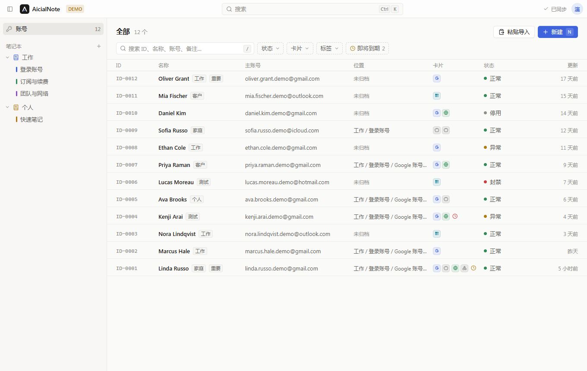
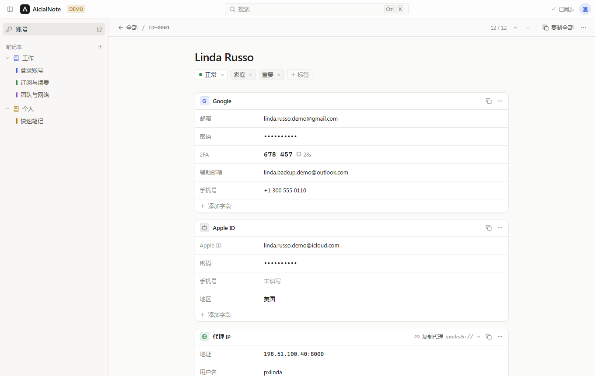
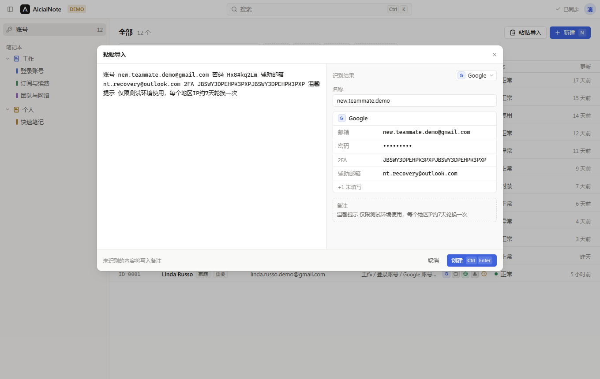

<div align="center">


# AicialNote

**계정 정보와 노트를 내 클라우드 드라이브에.**

로그인 정보, 비밀번호, 2FA, 복구 이메일, 프록시를 관리하는 오픈 소스 도구입니다.<br>
서버 측 데이터베이스가 없습니다. 데이터는 일반 파일 형태로 사용자의 Google Drive 또는 OneDrive에 저장됩니다.

[](https://aicialnotes.com)
[](../../LICENSE)
[](https://github.com/Eric-kbo/AnNote/actions/workflows/ci.yml)


**[aicialnotes.com에서 AicialNote 열기](https://aicialnotes.com)** ·
[셀프 호스팅](../../docs/self-hosting.md) ·
[데이터 형식](../../docs/data-format.md) ·
[버그 신고](https://github.com/Eric-kbo/AnNote/issues)

[English](../../README.md) · [简体中文](../../README.zh-CN.md) · [繁體中文](README.zh-TW.md) · [日本語](README.ja.md) ·
**한국어** · [Español](README.es.md) · [Deutsch](README.de.md) ·
[Français](README.fr.md) · [Português](README.pt-BR.md) · [Русский](README.ru.md)



</div>

## 목차

- [AicialNote를 쓰는 이유](#aicialnote를-쓰는-이유)
- [기능](#기능)
- [시작하기](#시작하기)
- [작동 방식](#작동-방식)
- [보안 모델](#보안-모델)
- [개발](#개발)
- [로드맵](#로드맵)
- [기여하기](#기여하기)
- [라이선스](#라이선스)

## AicialNote를 쓰는 이유

대부분의 비밀번호 관리자는 보관함을 자사 서버에, 자사 앱에서만 읽을 수 있는 형식으로 보관합니다. AicialNote는 그 반대입니다.

- **파일은 사용자의 것입니다.** 모든 데이터는 **사용자의** Google Drive 또는 OneDrive(또는 로컬 폴더)에 JSON으로
  저장되며, 그 옆에 Markdown과 CSV 사본이 생성됩니다. 내일 AicialNote가 사라지더라도 어떤 텍스트 편집기나
  Excel에서든 데이터를 열 수 있습니다.
- **서버는 데이터를 보지 않습니다.** 브라우저가 Google 및 Microsoft와 직접 통신합니다. 작은 Go 서버는 OAuth 로그인만
  처리하며 아무것도 저장하지 않습니다.
- **데이터를 잃기 어렵습니다.** 덮어쓸 때마다 이전 버전이 보존되고, 삭제한 항목은 휴지통 폴더로 이동하며, 동기화
  충돌이 발생하면 양쪽 버전을 모두 보존합니다.

> [!WARNING]
> **AicialNote는 알파 단계의 소프트웨어입니다.** 데모 모드와 로컬 폴더는 충분히 테스트되었지만, Google Drive와 OneDrive
> 동기화는 새로 도입된 기능입니다. 직접 사용하면서 신뢰할 수 있다고 확인될 때까지는 백업(**Export data… → Full backup (JSON)**)을
> 보관하고, 실제 비밀번호를 저장하기 전에 [보안 모델](#보안-모델)을 읽어 보세요.

## 기능

- **모든 신원을 하나의 목록으로.** 각 ID에는 카드를 담을 수 있습니다. Google, Apple ID, Microsoft, OpenAI, Claude,
  이메일, 웹사이트, API 키, 프록시, 서버, Wi-Fi, 은행 카드, 배송지 주소, 프로필, 신분증 또는 사용자 지정 카드입니다. 상태, 태그, 카드 유형, 만료 임박 여부로 필터링할 수 있습니다.
- **클릭 한 번으로 복사.** 아무 값이나 클릭하면 복사됩니다. 2FA 필드에는 현재 TOTP 코드가 실시간으로 표시됩니다.
- **스마트 붙여넣기.** `Email: a@gmail.com Password: …`, `email----password----recovery----2FA`,
  `ip:port:user:pass` 또는 이런 줄 백 개를 붙여넣으면 AicialNote가 필드를 채워 줍니다.
- **노트북.** 리치 텍스트 편집기를 갖춘 OneNote 스타일의 노트북, 섹션, 페이지를 제공합니다. 계정도 섹션에 정리해
  노트 옆에 둘 수 있습니다.
- **로컬 우선.** 읽기와 쓰기가 즉시 반영되며 오프라인에서도 작동합니다. 동기화는 백그라운드에서 이루어집니다.
- **가져오기와 내보내기.** 전체 JSON 백업, CSV 및 Markdown 내보내기를 지원하며, `trash/`에 있는 어떤 사본에서든 복원할 수 있습니다.
- **키보드 중심.** `Ctrl/⌘ K`, `/`, `J`/`K`, `N`, `Ctrl/⌘ V`. 라이트 및 다크 테마, 중국어와 영어 UI를 지원합니다.

<p align="center">
  
  
</p>

## 시작하기

### 호스팅 버전 사용하기

**[aicialnotes.com](https://aicialnotes.com)** 사이트에 접속해 Google 또는 Microsoft로 로그인하면 끝입니다. 설치할 것이
없습니다. 사이트는 자신이 만든 파일에 대한 권한만 얻습니다.

| 제공자       | 권한                        | AicialNote가 접근할 수 있는 범위               |
| ------------ | --------------------------- | ---------------------------------------------- |
| Google Drive | `drive.file`                | AicialNote가 만든 파일만                       |
| OneDrive     | `Files.ReadWrite.AppFolder` | `Apps/AicialNote` 폴더만                       |
| 로컬 폴더    | 브라우저 파일 접근          | 사용자가 선택한 폴더만(Chromium 기반 브라우저) |

### 직접 호스팅하기

AicialNote는 웹 앱이 내장된 단일 바이너리(또는 하나의 컨테이너)로 배포됩니다. Google 및/또는 Microsoft에 OAuth 앱을
등록하고, 환경 변수 네 개를 설정한 뒤 실행하세요. 자세한 내용은 [docs/self-hosting.md](../../docs/self-hosting.md)를 참고하세요.

## 작동 방식

```text
┌────────────────────┐   OAuth only    ┌─────────────────────────┐
│  Browser (React)   │ ───────────────▶│ AicialNote server (Go)  │  no database,
│  IndexedDB cache   │                 │ token broker + SPA      │  never sees data
└─────────┬──────────┘                 └─────────────────────────┘
          │ files (JSON / MD / CSV), directly
          ▼
   Google Drive  ·  OneDrive  ·  local folder
```

드라이브에는 다음과 같은 파일이 생깁니다.

```text
AicialNote/
├── vault.json                 settings
├── items/<id>.json            the data, one file per ID
├── notes/<id>.json            notebooks, sections and pages
├── history/<id>/…             previous versions, kept on every change
├── trash/                     deleted items
├── readable/                  generated Markdown and CSV copies (open in any editor or Excel)
└── index.json                 generated index
```

드라이브에 저장되는 형식은 버전이 관리되는 공개 규약입니다: [docs/data-format.md](../../docs/data-format.md).

## 보안 모델

- **AicialNote는 아직 데이터를 암호화하지 않습니다.** 드라이브의 파일과 브라우저의 로컬 캐시(IndexedDB)는 일반
  텍스트입니다. 안전성은 클라우드 계정과 기기의 보안 수준에 달려 있으므로 클라우드 계정에 2단계 인증을 켜 두세요.
  선택형 종단 간 암호화는 로드맵에 있습니다.
- **서버는 데이터를 보지 않습니다.** 서버는 OAuth 로그인만 처리합니다. 리프레시 토큰은 AES-GCM으로 암호화된
  HttpOnly 쿠키에 저장되며, 서버에는 데이터베이스가 없고 아무것도 저장하지 않습니다.
- **최소한의 권한.** [시작하기](#호스팅-버전-사용하기)의 표를 참고하세요.
- **엄격한 CSP.** `script-src 'self'`를 사용하며, `connect-src`에는 Google Drive와 OneDrive 호스트만 나열되어 있습니다.

취약점을 발견하셨나요? [SECURITY.md](../../SECURITY.md)에 안내된 방법으로 비공개로 신고해 주세요.

## 개발

요구 사항: Node 22+, pnpm 10+, Go 1.26+.

```sh
PLAYWRIGHT_SKIP_BROWSER_DOWNLOAD=1 pnpm install
pnpm dev            # 웹 앱: http://localhost:5173
pnpm dev:server     # :8080의 OAuth 브로커 (server/.env 필요, server/.env.example 참고)
```

개발 환경에서는 시작 페이지에 **Open demo data** 버튼이 있으며, 모든 것이 메모리에서 실행되므로 UI 작업에 OAuth
자격 증명이 필요하지 않습니다.

```sh
pnpm test           # 단위 테스트 (TypeScript + Go)
pnpm typecheck
pnpm lint
pnpm smoke          # `pnpm dev`를 대상으로 Chrome에서 E2E 검사
pnpm screenshots    # 라이트/다크, zh/en UI 스크린샷
pnpm build          # 웹 앱이 내장된 단일 바이너리: server/bin/aicialnote
```

| 경로               | 내용                                                             |
| ------------------ | ---------------------------------------------------------------- |
| `packages/core`    | 데이터 모델, 스마트 붙여넣기, TOTP, 읽기용 내보내기, 보관함 작업 |
| `packages/storage` | 스토리지 어댑터: Google Drive, OneDrive, 로컬 폴더, 메모리       |
| `web`              | React 앱: 로컬 캐시, 동기화 엔진, UI                             |
| `server`           | Go: OAuth 브로커 및 정적 파일 서버                               |
| `docs`             | 데이터 형식, 디자인 원칙, 셀프 호스팅                            |

프로젝트 현황, 설계 결정, 기여자 참고 사항: [docs/status.md](../../docs/status.md),
[docs/decisions.md](../../docs/decisions.md), [CLAUDE.md](../../CLAUDE.md).

## 로드맵

- [ ] 선택형 종단 간 암호화(같은 파일을 암호화된 봉투로 감쌈)
- [ ] 두 번째 드라이브로 미러링
- [ ] 설정에서 템플릿과 상태 사용자 지정
- [ ] OneNote / CSV에서 가져오기, 오프라인 HTML 뷰어로 내보내기
- [ ] UI 언어 추가
- [ ] 데스크톱 및 모바일 버전

## 기여하기

이슈와 풀 리퀘스트는 영어 또는 중국어로 환영합니다. [CONTRIBUTING.md](../../CONTRIBUTING.md)부터 읽어 주세요. 버그
수정보다 큰 변경이라면 접근 방식을 먼저 맞출 수 있도록 이슈를 먼저 열어 주세요.

## 라이선스

AicialNote는 **[GNU Affero General Public License v3.0](../../LICENSE)** 라이선스로 배포되는 자유 소프트웨어입니다.

누구나 사용, 연구, 수정, 재배포할 수 있습니다. 수정한 버전을 실행하여 네트워크를 통해 다른 사람이 사용하게 하는 경우,
동일한 라이선스로 소스 코드를 공개해야 합니다.

Copyright © 2026 Eric-kbo
